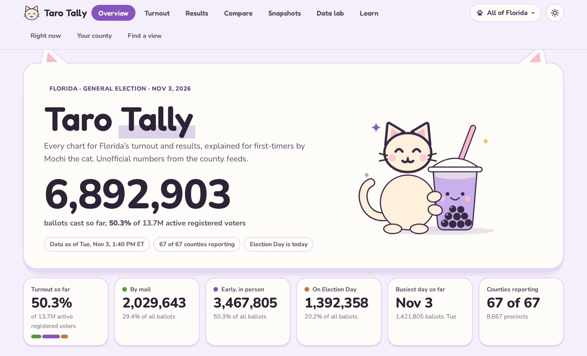

# Florida 2026 General Election — turnout tracker

> **Working on this repo? Read [`AGENTS.md`](AGENTS.md) first.** It documents every data source,
> schedule slot, file and schema, the immutability rules, and the audit.

**[Live viewer →](https://peribelle.github.io/2026-florida-election-tracker/)** — *Taro Tally*, one page, nothing to install.
It keeps itself current: every pull is committed and the page is rebuilt and pushed within a few minutes
(see [Publishing](#publishing)).

[](https://peribelle.github.io/2026-florida-election-tracker/)

Pulled live from all 67 counties. Election Day is Tuesday, November 3, 2026. The project tracks turnout (`runs/`),
the vote count (`results/`) and forecasts (`projections/`), and keeps the three apart.

## Setup

```bash
git clone https://github.com/peribelle/2026-florida-election-tracker.git
cd 2026-florida-election-tracker
python3 -m venv .venv && .venv/bin/pip install -r requirements.txt
```

Built and run on Python 3.14. Every source is public and needs no credentials.

## Refresh (one line)

```bash
./refresh.sh
```

Re-pulls every feed, rebuilds the CSV tables, workbook, county/site lists and chart preview,
prints the change since the last archived run, archives the run, then rebuilds the viewer
(that last step is guarded: a viewer failure can never fail a refresh) and asks for a GitHub update
(see [Publishing](#publishing); also guarded).

Optional alias:

```bash
echo 'alias flturnout="$HOME/Code/election-tracking/refresh.sh"' >> ~/.bashrc
```

## Deliverables

| Path | What it is |
|---|---|
| `Reports/Florida_2026_General_Turnout.xlsx` | Latest workbook: 16 tabs, 9 native charts |
| `Reports/viewer.html` | **Taro Tally**: interactive viewer, one file, opens offline (see below) |
| `Reports/charts_preview.png` | Chart contact sheet |
| `docs/index.html` | The published copy of the viewer (GitHub Pages serves `docs/`) |
| `docs/preview.png` | Screenshot of the viewer's top, rendered from the page itself: the image at the top of this README |
| `Reports/counties_and_election_sites.md` | All 67 counties: website, turnout link, eligible voters, ballots, % |
| `Reports/county_election_sites.csv` | Same, as data |
| `runs/<timestamp>/` | **Immutable archive of every run** |
| `runs/INDEX.csv` | **Append-only run log** (one row per run) |
| `runs/latest` | Symlink to the newest run (local only, not committed) |

`Reports/` is a convenience mirror of the newest run and is rewritten each time.
`runs/` is never rewritten — each run gets its own directory containing the raw feeds
(`raw_feeds.zip`), the tidy CSVs, the workbook, the chart preview, and a `manifest.json`
with a SHA-256 for every file.

## The viewer (`Reports/viewer.html`)

A single self-contained page with seven views. A **county menu** in the header tailors every view to one county.

| View | What it holds |
|---|---|
| **Overview** | Headlines written from the data, a county report card (rank on a dozen measures, similar counties), a clickable map, and a finder with every chart as a question |
| **Turnout** | 20 charts covering the standard chart types for turnout data, each answering for Florida or the chosen county |
| **Results** | Race board with forecasts, seat tally, the count race by race (map, county table, over time, voting method), local races and precinct detail |
| **Compare** | One to four counties side by side, for turnout and for any race, with the forecast strip. Shareable URL |
| **Snapshots** | Timeline of every saved pull (turnout, results, precinct, projections), A-versus-B comparisons, a replay slider, pipeline health |
| **Data lab** | Any county measure against any other: scatter, ranking, map, histogram, correlation matrix, similar counties, outliers, concentration, precinct leaderboard |
| **Learn** | Reading-charts habits, glossary and data notes |

Each chart has a plain-English note on what it is and how to read it, a table view, and light and dark themes.
Taro-boba-and-cats theme. Republican marks are red, Democratic blue, Independent yellow, and those colors mean nothing else.
Projections (DDHQ, Kalshi, Polymarket) sit beside the races they are about and are never mixed into the count.

```bash
.venv/bin/python build_viewer.py     # reads data/, runs/, results/, projections/ -> Reports/viewer.html
```

`refresh.sh` runs it after every turnout refresh, and `results.py` starts a detached rebuild after every results pull
(log in `logs/viewer_build.log`), so the file stays current; reload the page to see new data. All numbers are computed
from the same tables as the workbook; Broward is put on the active-registered basis (county and precincts) and its daily
mail/early split is derived from its early-voting-site counts. Blurbs recompute from the data, and the page adapts once
Election Day ballots and results appear. Before polls close every count is zero and the results views show the ballot
preview and the forecasts instead.

Source lives in `viewer/`: `template.html`, `style.css`, `js/*.js` (concatenated in filename order),
`fonts/` (Fredoka and Nunito, OFL) and `fl_counties.json` (county outlines from Census boundaries via us-atlas;
regenerate with `viewer/make_geo.py`, one-time). Edit those, then re-run `build_viewer.py`.

## Publishing

Every pull ends with `after_pull.py`, which asks two detached workers for a job: `validate.py` (next section) and
`publish.py`. `refresh.sh`, `results.py`, `results_precinct_slow.py` and `projections.py` all do. Neither can make a pull
wait or fail. One publish:

1. rebuilds `Reports/viewer.html` (skipped if nothing is newer than it),
2. copies it to `docs/index.html` and renders `docs/preview.png` from it, the image at the top of this README,
3. commits `data/`, `raw/`, `Reports/`, `runs/`, `results/`, `projections/`, `validation/` and `docs/`, and never code,
4. pushes `main`. GitHub Pages serves `docs/` and redeploys by itself.

Asks that arrive while a publish is running collapse into one more. It waits for the files to stop changing, and for the
validators to finish, before it commits, and spaces pushes 5 minutes apart because Pages soft-limits builds to 10 an hour, so the site trails a pull
by a minute or a few. A failed push is retried, and local commits go out with the next successful one. Pushes use
`github_known_hosts` (GitHub's published host keys), so nothing ever waits on a prompt.

```bash
.venv/bin/python publish.py           # publish now, in the foreground
.venv/bin/python publish.py --status  # last result, pending request, unpushed commits
NO_PUBLISH=1 ./refresh.sh             # skip publishing for one run
```

Log: `logs/publish.log`. A night of 49 results pulls adds roughly 250 MB of archives to the repo.

## Validators

Two validators check every pull, so a problem is flagged in minutes and not found the next morning. They run after each
pull (`validate.py`, started by `after_pull.py`), detached, so a pull never waits on them.

| Tier | Means | Examples |
|---|---|---|
| **1 Critical** | look now | votes dropped by hundreds; a source is down; a county page is for the wrong election; a race call was taken back |
| **2 Warning** | look soon | one county site failed; a smaller drop in votes; a table came back short; a scheduled pull never ran |
| **3 Notice** | good to know | a few votes of correction; a county came online; a race was called |

- **Source validator** asks *did it pull?* It compares each pull with the best this pipeline has managed before: the state
  results site (Florida Election Watch), every county results site, the precinct files, the turnout feeds, and DDHQ, Kalshi
  and Polymarket. A county that never had a precinct file is structure; one that had it and lost it is news. County sites
  *appearing* during the night is normal and only ever a notice.
- **Data validator** asks *do the numbers make sense?* **Every race, county, precinct and number is compared with the last
  pull.** A count that went down is flagged however small, and the tier says how big. Parts must add up to their totals,
  nothing may be negative, a candidate cannot have more votes than the county has ballots, probabilities stay between 0 and
  1, and a race that was called stays called. Rows that only changed their key while the numbers carried over are a
  notice, not an alarm.
- A flag is **raised once**. If it stays true it is escalated one tier after 3 pulls and **cleared** when it goes away, so a
  broken county is one alert, not a hundred.
- **The watchdog** (`validate.py --watch`) is a small loop that raises an alert when a scheduled pull never arrives at all,
  which no after-the-pull check can see. Start it once with
  `nohup .venv/bin/python validate.py --watch >> logs/validate_watch.log 2>&1 &`; it is silent outside the election window
  and retires itself after it. Stop it early with `pkill -f 'validate.py --watch'`.

Where it lands: `validation/alerts.csv` (append-only log), `validation/<run>/findings.csv` (every row behind an alert, so
nothing is summarised away), `validation/current.json` (what is open now). A tier 1 or 2 alert also pops a desktop
notification. On the site, the **Data checks** card (Snapshots → Pipeline health) and a chip on the Overview show the same.

```bash
.venv/bin/python validate.py --status     # what is open right now
.venv/bin/python validate.py --replay     # what the saved history would have been flagged (writes nothing)
.venv/bin/python validate.py --selftest   # prove the validators fire: runs 46 checks on a copy of the real data
NO_VALIDATE=1 ./refresh.sh                # skip the validators for one run
touch logs/.validate_quiet                # mute the desktop popups (alerts are still logged and on the site); rm to unmute
```

Log: `logs/validate.log`.

## Where the data comes from

- **66 counties**: every county except Broward publishes unofficial turnout through VR Systems
  *Turnout Quick View* — the widget on the county's own turnout page. `collect.py` reads
  `turnoutquickview.electionsfl.org/data/FL/<COUNTY>/<election>/data.json` and stores the whole record:
  date × type, party × type, precinct × type × eligible voters, location × party, location × day.
- **Broward**: its own dashboard at `my.browardvotes.gov/TEDElectionLink`, backed by a JSON/HTML API.
  `collect_broward.py` pulls the summary KPIs, the ballot-type mix, the party table, all 346 precincts
  and the 281 Election Day locations. Broward publishes turnout against *all* registered voters;
  the workbook maps it onto active registered so the 67 counties compare like for like. Its dashboard is a separate
  site that can fail on its own: if it does, the run keeps Broward's last complete numbers, says so in the run's note
  and in `data/broward/status.json`, and the validators raise it, so the other 66 counties still get their pull.
- **Denominators**: FL Division of Elections book-closing report (Oct 5, 2026), active registered
  voters by county / party / precinct.

## Tabs

`README` · `County Summary` · `Elections Sites` · `By Party` · `By Ballot Type` · `By Precinct` ·
`Precinct x Type` · `By Date` · `Locations` · `Location x Party` · `Location x Day` ·
`Precinct Registration` · `County Registration` · `Charts` · `Method & Caveats`

## Election-day plan (automated)

```bash
nohup ./election_day.sh &        # runs the whole day, logs to logs/
./election_day.sh --status       # what has run so far
./election_day.sh --dry-run      # just print the schedule
```

| Phase | When | What it runs |
|---|---|---|
| Turnout | top of every hour, 7:00 AM – 6:00 PM, **plus a final pull at 6:59 PM** | `./refresh.sh` (county turnout feeds) |
| Results | every 10 minutes, 7:00 PM – 3:00 AM | `results.py` (Florida Election Watch) |
| Projections | **:20 and :50**, 7:00 PM – 3:00 AM, backgrounded | `projections.py` (forecasts, calls, markets) |

Started before election day, the scheduler idles until 07:00 on Nov 3 and does nothing before then.

Every pull above ends by asking for a GitHub update, so the repo and the site follow the data (see [Publishing](#publishing)).

The 6:59 PM pull exists because the county turnout widgets are switched off at polls close;
that run captures the last state of the feeds one minute before they go dark.

Cron equivalent, if you'd rather not keep a process alive. `--once` fires only if the
current clock matches a scheduled slot *and* the date is election day (or the small hours
after it), so these lines are safe to leave installed:

```cron
0 7-18 * * *       cd $HOME/Code/election-tracking && ./election_day.sh --once
59 18 * * *        cd $HOME/Code/election-tracking && ./election_day.sh --once
*/10 19-23 * * *   cd $HOME/Code/election-tracking && ./election_day.sh --once
*/10 0-2 * * *     cd $HOME/Code/election-tracking && ./election_day.sh --once
0 3 * * *          cd $HOME/Code/election-tracking && ./election_day.sh --once
```

Cron is the more robust option: every pull is an independent process, a failure can't kill
the schedule, and it survives you closing the terminal or logging out.

## Results tracking (after 7 PM)

County turnout widgets are switched off at polls close, so results come from
**Florida Election Watch** — `floridaelectionwatch.gov`, the Division of Elections' public
unofficial-results site. No credentials, no news subscription.

`results.py` snapshots three things each pull:

| Page | Contents |
|---|---|
| `/CountyReportingStatus` | per county: turnout, eligible active voters, turnout %, precincts reporting/completed, VBM / early / provisional ballots completed |
| `/ElectionDayTurnout` | per county: turnout and last-reported time |
| `/ContestResultsByCounty/<id>` | votes by county for every statewide contest (Governor, AG, CFO, Agriculture, U.S. House districts) |

Each pull is archived to `results/<timestamp>/` with the raw HTML gzipped, parsed CSVs
(`county_status.csv`, `ed_turnout.csv`, `contest_votes.csv`, `county_contests.csv`) and a row
in `results/INDEX.csv`. Nothing is overwritten.

### Precinct level

Alongside the state pull, `results_precinct.py` runs one request per county against the
Clarity "Candidate Results by Precinct and Party (CSV)" export and writes **one spreadsheet
per county** to `results/<timestamp>/precincts/<County>.xlsx`:

| Sheet | Contents |
|---|---|
| Summary | county, contests, precincts, totals by ballot type |
| By Precinct | precinct x mail / early / election day / total |
| By Contest | contest x mail / early / election day / total |
| Data | every candidate in every precinct (long format) |

The source CSV is also kept gzipped in `results/<timestamp>/raw/precinct_<CODE>.csv.gz`.
A full pull is ~5 MB and takes ~10 seconds; a night of 49 pulls is roughly 250 MB.

Not every county exposes that export. Counties whose Clarity build has no `/Reports/` CSV are
handled by `results_precinct_slow.py`, which parses one page per contest
(`/Precincts/<contest>/`, one block per precinct). That costs ~550 requests instead of ~46, so
it runs on its own cadence — **:15 and :45**, 16 times overnight instead of every 10 minutes —
and writes to `results/slow/<timestamp>/precincts/<County>.xlsx` with the same four sheets.

Both pull types record failures in `precinct_summary.json` / `slow/<timestamp>/summary.json`,
so a missing county is always visible rather than silently absent.

Election-day total: 13 turnout runs + 49 results pulls + 16 slow precinct pulls = 78,
plus 16 projections pulls riding alongside the results phase.

Note: the state site uses **active registered voters** for every county (13,704,495), so it
resolves the Broward denominator problem on its own.

## Projections and calls (separate from the count)

`results/` is the vote count. `projections/` is what people *think* will happen, plus a record of
who has been called the winner. The two are never mixed: a probability in `results/` would be a bug.

Three free sources, no credentials, each pulled into the same snapshot:

| Source | Gives |
|---|---|
| **DDHQ Votes** | forecast `win_probability` per candidate, and the race call (`winner`, `called_at`) — Governor, US Senate special, all 28 US House |
| **Kalshi** | market price per candidate — Governor, Senate, CFO, 4 House districts |
| **Polymarket** | market price per party — Governor, Senate |

Nobody forecasts AG, Agriculture Commissioner, the legislature, judicial retention or the
amendments. Those are simply absent rather than filled with a guess.

Each source runs as its own process with its own timeout, so one failing pull cannot affect the
others or delay `results.py` — the whole projections run is backgrounded behind a file lock. A
failed source shows up as `ok: false` in `summary.json` and its CSV is missing; the rest still land.

Per pull that yields:

- `predictions.csv` — every (source, race, candidate) probability
- `calls.csv` — DDHQ's call state, the only columns that say a race is decided
- `divergence.csv` — where the model and the markets disagree, widest first
- `coverage.csv` — which sources cover each race

Divergence is kept visible on purpose. On the Senate race the model and the markets differed by
~12 points the night before the election; averaging that away would have hidden the one genuinely
interesting fact in the data.

A pull is ~1.5 MB of archived raw pages and takes a few seconds.

```bash
.venv/bin/python projections.py            # one snapshot
.venv/bin/python projections.py --only ddhq  # a single source
```

## Election-night cadence

Florida rule, per the Division of Elections timeline:

- **7:30 PM local** — preliminary returns due: all early voting and all vote-by-mail tabulated
  through the end of early voting.
- **Every 45 minutes after** — precinct-level Election Day results, until complete.
- **8:00 PM Eastern** — first statewide release (Florida spans two time zones).
- **~99% reported by midnight** in 2016 and 2020.
- **Noon, Sat Nov 7** — unofficial returns due (4th day after the election).

Note: county turnout dashboards, including the shared feed, are typically switched off at 7 PM
on Election Day and replaced by election-results pages. Tracking after that means watching
Florida Election Watch (`floridaelectionwatch.gov`) and each county's Clarity/ENR results site,
not the turnout feed.

## Individual steps

```bash
.venv/bin/python collect.py         # 67 shared feeds -> raw/tqv/
.venv/bin/python collect_broward.py # Broward dashboard -> data/broward/
.venv/bin/python normalize.py       # tidy tables -> data/*.csv
.venv/bin/python build_workbook.py  # -> Reports/Florida_2026_General_Turnout.xlsx
.venv/bin/python write_lists.py     # -> Reports/counties_and_election_sites.md/.csv
.venv/bin/python make_preview.py    # -> Reports/charts_preview.png
.venv/bin/python report_delta.py    # prints totals + change vs last archived run
.venv/bin/python archive.py         # -> runs/<timestamp>/ + runs/INDEX.csv
.venv/bin/python build_viewer.py    # -> Reports/viewer.html
```

## Validation

- County-reported eligible voters vs. DOS book closing: median difference 0.03%.
- Each county's party totals, precinct totals and ballot-type totals reconcile to the same count.
- The two pre-archive runs are logged in `runs/INDEX.csv` and flagged `RECONSTRUCTED` —
  their raw feeds were overwritten before archiving existed.

## What is not in this repo

`.gitignore` leaves out `.venv/`, `logs/`, the `runs/latest` symlink (an absolute path on one machine) and verbatim
copies of third-party pages and code: DDHQ's raw pages (`projections/<timestamp>/raw/`, `senate_rsc.txt`) and the
vendor's `raw/TQV.js`. They stay on disk where they were captured. Every parsed CSV and JSON the viewer reads is committed.

## Disclaimer

Unofficial. Counts come from public election-night feeds and change as counties report and canvass; official results
are the ones certified by Florida's canvassing boards. Forecasts and market prices (DDHQ, Kalshi, Polymarket) are
predictions, not votes. This project is not affiliated with the State of Florida, any county, DDHQ, Kalshi or Polymarket.

Fonts: Fredoka and Nunito, SIL Open Font License 1.1 (license texts in `viewer/fonts/`).
